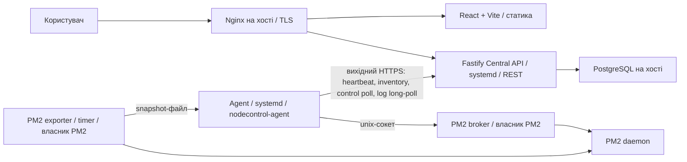
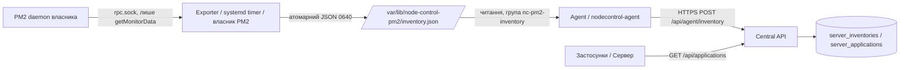
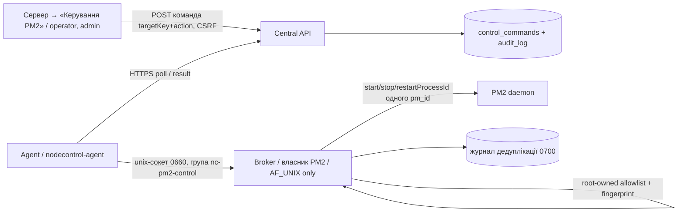
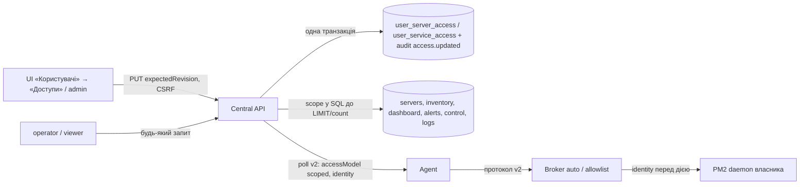

# Архітектура Node Control

Стан перевірено за кодом 2026-10-12 (після Task 002). Документ розрізняє реалізоване і ціль MVP1.

## Реалізовано

ES modules, залежності `pg` і `fastify`, npm scripts. Скрипти Task 001 тестуються вбудованим `node:test`, backend — Vitest. `backend/` містить Central API: health endpoints, authentication (сесії, CSRF), RBAC, audit log (Task 005); `frontend/` — React/Vite UI (Task 006); `agent/` — Node.js Agent із вихідним HTTPS heartbeat (Task 007). Є версійні міграції `backend/migrations/` (користувачі, сесії, audit, сервери, inventory, керування, сповіщення). Є реєстр серверів і heartbeat Agent (Task 007), read-only PM2 inventory через локальний exporter (Task 008, ADR-016), керування явно дозволеними PM2-процесами через локальний broker (Task 009, ADR-017; за замовчуванням вимкнено ключем `PM2_CONTROL_ENABLED`, вмикається явно), обмежений перегляд логів (Task 010, ADR-018), користувачі (ADR-019), Dashboard (ADR-020) і сповіщення (ADR-021/022). Redeploy через Jenkins і WebSocket відсутні.

| Шлях | Фактична відповідальність |
|---|---|
| `scripts/setup-postgres.js` | Запуск від root на хості БД: роль, БД, ACL, `.env`, додавання HBA-правила та reload |
| `scripts/db-check.js` | Підключення з `.env`, SELECT 1, показ версії й факту SSL |
| `scripts/check-secrets.js` | Перевірка `.env` у Git і сканування файлів, що можуть потрапити в commit |
| `scripts/lib/` | Конфігурація, env, генерація пароля, SCRAM, SQL builders, HBA parser, setup plan, scanner |
| `tests/unit/` | 46 тестів допоміжної логіки без БД (node:test) |
| `tests/integration/` | Env, реальна БД, каталоги, права, SCRAM; привілейовані серверні перевірки |
| `backend/src/config.ts` | Читання `.env` (`ENV_FILE`) + process env (пріоритет), валідація, ліміти pool/timeout |
| `backend/src/database.ts` | `pg.Pool` (max 5, кінцеві таймаути), `check()` = `SELECT 1`, ідемпотентний `close()`, маскування помилок |
| `backend/src/app.ts` | Fastify factory: логер із redaction, request ID, `/health/live`, `/health/ready`, 404/500 handlers; не слухає порт |
| `backend/src/lifecycle.ts` | `listen`, ідемпотентний shutdown із таймаутом, SIGINT/SIGTERM |
| `backend/src/errors.ts` | Політика помилок: `describeError` (лише category + allowlisted code), `toErrorResponse` (фіксований публічний контракт) |
| `backend/src/server.ts` | `runServer`: логіка executable (config → app → listen → сигнали), гарантоване завершення після невдалого старту |
| `backend/src/main.ts` | Точка входу: `.env` + process env, fatal handlers, виклик `runServer`, exit code |
| `backend/src/migrations.ts`, `migrate-cli.ts`, `migrate.ts` | node-pg-migrate: `status` (read-only), `up` (advisory lock, одна транзакція, timeouts); окремий CLI, API міграції не запускає |
| `backend/migrations/` | Версійні SQL-міграції: `1791900000000_create-users`, `1791900000001_auth-foundation` (role, sessions, audit_log) |
| `backend/src/auth/` | `password` (scrypt, limiter), `tokens` (session/CSRF/cookie), `rbac`, `rate-limit`, `email`, `store` (SQL + транзакції з audit), `plugin` (hooks + `/api/auth/*`, `/api/audit` з читабельним `context`, ADR-033), `bootstrap` |
| `backend/src/bootstrap-cli.ts`, `bootstrap-admin.ts` | CLI створення першого адміністратора (без HTTP) |
| `frontend/src/api/` | API-клієнт (timeout, cancel, runtime-валідація) і типи контракту |
| `frontend/src/auth/` | `AuthContext` (сесія в пам'яті, епохи проти гонок), guards (`RequireAuth`, `RequirePermission`, безпечний redirect) |
| `frontend/src/pages/`, `components/` | Login, Огляд, Сервери, Застосунки (PM2 inventory; дії й логи за правами, ADR-024), Сповіщення, Користувачі, Журнал аудиту, Налаштування, Обліковий запис; Layout із навігацією за правами; спільні дії з процесами — `processActions.tsx` (меню рядка, підтвердження, tracking команд), `useServerCapabilities.ts`, `ActionMenu.tsx`; робоча область «Застосунки» (ADR-029) — компактний список `ApplicationList.tsx` і деталі вибраного процесу `ApplicationDetail.tsx`, breakpoint `useMediaQuery.ts`; обмежений перегляд логів — `LogTail` (inline) і `LogViewer` (dialog) у `LogViewer.tsx` (ADR-026); «Сповіщення» (ADR-031) — `AlertsPage.tsx`, тексти й показники інцидентів `incidents.ts`, деталі в спільному `Dialog.tsx`; «Журнал аудиту» (ADR-032) — `AuditPage.tsx`, назви подій, ініціатор і ціль `auditEvents.ts` |
| `e2e/` | Playwright: реальний backend + збірка UI + Agent на тестовій БД |
| `backend/src/servers/` | Реєстр серверів (SQL, keyset), credentials агентів (digest), heartbeat (FOR SHARE + монотонний upsert), контракт snapshot |
| `agent/src/` | Agent: конфіг (HTTPS-only, файл 600), snapshot (`node:os`), heartbeat (timeout, `redirect: 'error'`), цикл (без overlap, backoff + jitter) |
| `frontend/src/pages/Server*.tsx` | Список/деталі серверів, опитування лише видимої вкладки, одноразовий діалог ключа, секція застосунків PM2 |
| `agent/src/pm2/`, `agent/src/pm2-exporter.ts` | PM2 exporter (ADR-016): клієнт протоколу PM2 лише для `getMonitorData` до існуючого daemon, allowlist-санітизація, запуск від власника PM2 через systemd timer |
| `agent/src/inventory/` | Контракт snapshot, атомарний запис / безпечне читання файлу, звіт Agent → API (окремий цикл) |
| `backend/src/servers/inventory*.ts` | Machine `POST /api/agent/inventory`, `GET /api/applications`, `GET /api/servers/:id/applications`; SQL з впорядкуванням і заміною набору |
| `frontend/src/pages/ApplicationsPage.tsx`, `components/Inventory.tsx` | Таблиця процесів, фільтри/курсор в URL, явна свіжість (актуально/застаріло/недоступно/офлайн) |
| `backend/test/support/test-db.ts` | Guard real-DB тестів: лише `TEST_DB_*`, відхилення production, per-run схема |
| `scripts/setup-test-db.js` | Root: ізольована `node_control_test_db`/`node_control_test_user` |
| `backend/test/` | Vitest: unit/API (inject), `smoke/` (скомпільований dist), `db/` (opt-in реальна БД, лише SELECT 1) |

`ENV_PATH` прив'язаний до кореня checkout; `/etc/pm2-dashboard/.env` отримується лише якщо код розміщено в цьому каталозі. Setup використовує DB_NAME/DB_USER із config та відмовляється змінювати БД з чужим власником. Повторний запуск примусово застосовує атрибути ролі та ACL; це не повний no-op. Пароль змінюється лише при створенні ролі або явному `--rotate-password`; `.env` записується до зміни пароля.

HBA-правило в коді: `hostssl node_control_db node_control_user 0.0.0.0/0 scram-sha-256`. Воно обмежене БД/роллю, але дозволяє будь-яку IPv4-адресу. Попередні правила HBA можуть збігтися раніше. `dbConfigFromEnv` не задає `ssl`; перевірка SCRAM не є перевіркою TLS. Публічний доступ не дозволений архітектурою без окремого підтвердження.

### Central API (Task 002)

```text
main.ts ── installFatalHandlers ── runServer(mergeEnv(.env, process.env))
server.ts ── loadConfig ──► ConfigError → stderr, exit 1
   │
   ├─ buildApp({ createDatabase }) ── Fastify (без listen, без signal handlers)
   │      └─ onClose → database.close() → pool.end()
   └─ createLifecycle(app).start() → listen 127.0.0.1:3100
          помилка listen → shutdown (таймаут) → StartupError{cleanedUp} → exit 1 (одразу / unref-таймер)
          SIGINT/SIGTERM → shutdown (один раз, таймаут 10 с) → exit 0 / 1
```

Health endpoints публічні навмисно. `/api/*` проходить auth-hook: Origin → сесія → CSRF → permission (ADR-011); кожен маршрут декларує `config.access`. API підключається до PostgreSQL лише по loopback (або SSH-тунелю в розробці) без TLS у `pg`; пряме віддалене підключення не підтримується без окремого рішення.

## Поточна архітектура (оновлено в Task 010)



Прийняті рішення (не плани): транспорт Agent — лише вихідний HTTPS із bounded polling/long-poll (ADR-015…018), без WebSocket; модель ролей admin/operator/viewer з permissions (ADR-011, `logs:read` — ADR-018); схема БД і міграції — версійні SQL через node-pg-migrate (ADR-009); PM2 — лише через exporter (read-only) і broker (allowlist) від власника PM2.

Реалізовано: auth/RBAC/audit, реєстр серверів, heartbeat, PM2 inventory, керування дозволеними процесами, перегляд обмеженого хвоста логів, адміністрування користувачів і зміна власного пароля (ADR-019: `users.credential_version`, відкликання всіх сесій, серіалізація адмінських мутацій), Dashboard поточного стану (ADR-020: `GET /api/dashboard`, один узгоджений read-only знімок, точні агрегати й обмежені списки), alerts engine і Slack (ADR-021: worker в API-процесі, durable інциденти й outbox, вимкнено за замовчуванням), admin-налаштування сповіщень і Slack-інтеграції без restart (ADR-022: settings у БД з revision, webhook AES-256-GCM, ключ лише в api.env, outbox прив'язаний до generation). **Не реалізовано:** Jenkins redeploy, історія метрик та retention, acknowledgement/silencing alerts, admin-reset пароля, MFA, кілька PM2 owners, видалення процесів, менеджер секретів-інтеграція.

### Перегляд логів (Task 010, ADR-018)

UI → `POST /api/servers/:id/log-requests` (`logs:read`, CSRF) → запит у пам'яті API → long-poll Agent `POST /api/agent/logs/poll` → broker `logs` (allowlist `logs: true`, ідентичність, шляхи з PM2 у дозволених каталогах, хвіст ≤ 256 KiB, ≤ 100 рядків, ≤ 8 KiB, маскування) → `POST /api/agent/logs/result` → `GET /api/log-requests/:id` (лише ініціатор). Текст не зберігається в БД, audit чи журналах; TTL у пам'яті 60 с.

## Життєвий цикл і майбутня фаза

API та Agent: Node.js 22 через systemd, без root за замовчуванням; усі units і інструменти Node Control запускають один runtime `/opt/node-control-runtime/bin/node` (окремий офіційний Node.js або посилання на сумісний системний, ADR-027). PM2 використовується лише для керованих Node.js-проєктів; API/Agent не запускати через PM2. Agent залишається незалежним від PM2, обмежується дозволеними процесами, Linux-користувачем та PM2_HOME.

Frontend збирається у статичні файли (`current/frontend/dist`) й обслуговується host Nginx; окремий production Node.js-процес не потрібен. API — `127.0.0.1:3100`; публічно UI і `/api/` віддає host Nginx на `https://control.example.com` (конфіг і TLS — власник сервера, DEPLOYMENT).

Central API забезпечує RBAC; метрики застосунків (PM2) — CPU, пам'ять, uptime, restart count і статус. Із серверних показників — лише поточний load average і доступність Agent (heartbeat, online/offline, freshness); системний моніторинг серверів виконує Zabbix, історії серверних метрик немає (ADR-023). Slack: пороги застосунків і захист від alert spam.

Новий код — TypeScript зі строгими типами та environment-конфігурацією. Чинні JS-скрипти читають `.env` із checkout; конфігурація майбутніх сервісів ще не реалізована. Безпеку каналу й автентифікації Agent/API окремо спроєктувати та протестувати до production-активації; схема вище не визначає протокол.

Після MVP, успішних тестів і стабілізації production окремо розглянути Docker для API/Agents за новим завданням. Зараз не створювати Dockerfile/Compose, контейнерні залежності чи контейнери. PostgreSQL і Nginx залишаються на хості; їх перенесення не погоджено.

Деплой і невизначені параметри — [DEPLOYMENT](DEPLOYMENT.md); первинне встановлення з checkout одним `./install.sh` (підготовка runtime і релізу — `installer/bootstrap`, інсталятори — `installer/`, ADR-027) — [INSTALLATION](INSTALLATION.md).

## PM2 inventory (Task 008, ADR-016)



Лише читання: керуючих маршрутів і команд немає. Exporter не має мережі й секретів API, Agent не має доступу до PM2, API не має доступу до серверів.

## Керування дозволеними PM2-процесами (Task 009, ADR-017)



| Шлях | Відповідальність |
|---|---|
| `agent/src/control/` | протокол Agent⇄broker, allowlist, ідентичність (fingerprint), журнал, виконавець, сервер сокета, клієнт і цикл Agent; логи: `logs-protocol.ts`, `logs.ts` (безпечне читання хвоста), `logs-loop.ts` (long-poll Agent) |
| `agent/src/pm2-broker.ts` | entrypoint broker (`serve`, `fingerprint`) |
| `backend/src/servers/control*.ts` | контракт, SQL lifecycle (claim/lease/expiry/unknown, idempotency, audit), маршрути |
| `frontend/src/components/ProcessControl.tsx` | цілі, підтвердження, статус команди, історія |
| `deploy/systemd/node-control-pm2-broker@.service` | broker від власника PM2, без мережі |

Довільного remote execution немає: від API до broker доходять лише `targetKey` і дія з enum; broker виконує лише три PM2-методи для цілей з root-owned allowlist.

## Доступи за ролями, серверами й сервісами (ADR-028)

Доступ = дозвіл ролі на операцію (ADR-011) **і** призначення на ресурс. `admin` — усі сервери й сервіси, зокрема майбутні; `operator` — перегляд, керування й логи в межах призначень; `viewer` — лише перегляд у межах призначень. Без призначень operator/viewer не бачать нічого.



| Шлях | Відповідальність |
|---|---|
| `backend/migrations/1791900000009_access-grants.sql` | таблиці призначень, `users.access_revision`, `service_name`/`target_identity` команд, `identity`/`protocol`/`mode`/`targets_total` статусу broker |
| `backend/src/auth/scope.ts` | спільні SQL-фрагменти `serverVisibleSql`/`serviceVisibleSql`, `serviceGranted` (FOR SHARE), `AccessChecker` для логів |
| `backend/src/auth/access-store.ts`, `access-routes.ts` | адміністрування призначень (admin): атомарна заміна, ревізія → 409, валідація, audit |
| `backend/src/servers/*-store.ts` | усі списки, пошук, пагінація, агрегати й історія фільтруються scope; claim команди повторно перевіряє роль, призначення й identity |
| `agent/src/control/` | протокол v2 (mode, identity, до 500 цілей, `total`), режим `auto` (цілі — усі процеси власника, ключ `n-<sha256(name)[:24]>`), узгодження версій з fail closed |
| `installer/src/agent.ts` | `--control-mode auto|allowlist`: новий broker — `auto`; наявний перемикається лише явно, з резервною копією |
| `frontend/src/components/AccessDialog.tsx` | редактор доступів (пошук серверів, режим «Усі сервіси»/«Вибрані», сервіси, що зникли, позначені «недоступний») |

Ідентичність сервісу — `(server_id, назва PM2-процесу)`; `pm_id` не використовується. 403 — брак дозволу ролі, 404 — ресурс не надано або не існує (без розкриття існування).

Логи (уточнено за review `e621e31`): права перевіряються в момент кожної дії — створення запиту, передачі Agent (поточні роль/активність/призначення автора, той самий сервіс і `identity` за `targetKey`), читання broker v2 (очікувані `name`/`identity`) і видачі результату (`app.revalidateSession` + новий scope). Legacy v1 — лише admin. `broker.total` — лише admin і режим «Усі сервіси».
