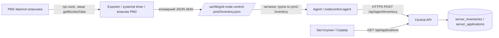

# Архітектура GOIT Node Control

Стан перевірено за кодом 2026-10-12 (після Task 002). Документ розрізняє реалізоване і ціль MVP1.

## Реалізовано

ES modules, залежності `pg` і `fastify`, npm scripts. Скрипти Task 001 тестуються вбудованим `node:test`, backend — Vitest. `backend/` містить Central API: health endpoints, authentication (сесії, CSRF), RBAC, audit log (Task 005); `frontend/` — React/Vite UI (Task 006); `agent/` — Node.js Agent із вихідним HTTPS heartbeat (Task 007). Є версійні міграції (`users`, `sessions`, `audit_log`). Є реєстр серверів і heartbeat Agent (Task 007) та read-only PM2 inventory через локальний exporter (Task 008, ADR-016); керування процесами, логи застосунків і WebSocket відсутні.

| Шлях | Фактична відповідальність |
|---|---|
| `scripts/setup-postgres.js` | Запуск від root на хості БД: роль, БД, ACL, `.env`, додавання HBA-правила та reload |
| `scripts/db-check.js` | Підключення з `.env`, SELECT 1, показ версії й факту SSL |
| `scripts/check-secrets.js` | Перевірка `.env` у Git і сканування файлів, що можуть потрапити в commit |
| `scripts/lib/` | Конфігурація, env, генерація пароля, SCRAM, SQL builders, HBA parser, setup plan, scanner |
| `tests/unit/` | 46 тестів допоміжної логіки без БД (node:test) |
| `tests/integration/` | Env, реальна БД, каталоги, права, SCRAM; привілейовані серверні перевірки |
| `docs/server-audit.md` | Історичний звіт Task 001 про сервер, не поточна незалежна перевірка |
| `backend/src/config.ts` | Читання `.env` (`ENV_FILE`) + process env (пріоритет), валідація, ліміти pool/timeout |
| `backend/src/database.ts` | `pg.Pool` (max 5, кінцеві таймаути), `check()` = `SELECT 1`, ідемпотентний `close()`, маскування помилок |
| `backend/src/app.ts` | Fastify factory: логер із redaction, request ID, `/health/live`, `/health/ready`, 404/500 handlers; не слухає порт |
| `backend/src/lifecycle.ts` | `listen`, ідемпотентний shutdown із таймаутом, SIGINT/SIGTERM |
| `backend/src/errors.ts` | Політика помилок: `describeError` (лише category + allowlisted code), `toErrorResponse` (фіксований публічний контракт) |
| `backend/src/server.ts` | `runServer`: логіка executable (config → app → listen → сигнали), гарантоване завершення після невдалого старту |
| `backend/src/main.ts` | Точка входу: `.env` + process env, fatal handlers, виклик `runServer`, exit code |
| `backend/src/migrations.ts`, `migrate-cli.ts`, `migrate.ts` | node-pg-migrate: `status` (read-only), `up` (advisory lock, одна транзакція, timeouts); окремий CLI, API міграції не запускає |
| `backend/migrations/` | Версійні SQL-міграції: `1791900000000_create-users`, `1791900000001_auth-foundation` (role, sessions, audit_log) |
| `backend/src/auth/` | `password` (scrypt, limiter), `tokens` (session/CSRF/cookie), `rbac`, `rate-limit`, `email`, `store` (SQL + транзакції з audit), `plugin` (hooks + `/api/auth/*`, `/api/audit`), `bootstrap` |
| `backend/src/bootstrap-cli.ts`, `bootstrap-admin.ts` | CLI створення першого адміністратора (без HTTP) |
| `frontend/src/api/` | API-клієнт (timeout, cancel, runtime-валідація) і типи контракту |
| `frontend/src/auth/` | `AuthContext` (сесія в пам'яті, епохи проти гонок), guards (`RequireAuth`, `RequirePermission`, безпечний redirect) |
| `frontend/src/pages/`, `components/` | Login, Огляд, Сервери, Застосунки (PM2 inventory, лише перегляд), Журнал аудиту; Layout із навігацією за правами |
| `e2e/` | Playwright: реальний backend + збірка UI + Agent на тестовій БД |
| `backend/src/servers/` | Реєстр серверів (SQL, keyset), credentials агентів (digest), heartbeat (FOR SHARE + монотонний upsert), контракт snapshot |
| `agent/src/` | Agent: конфіг (HTTPS-only, файл 600), snapshot (`node:os`), heartbeat (timeout, `redirect: 'error'`), цикл (без overlap, backoff + jitter) |
| `frontend/src/pages/Server*.tsx` | Список/деталі серверів, опитування лише видимої вкладки, одноразовий діалог ключа, секція застосунків PM2 |
| `agent/src/pm2/`, `agent/src/pm2-exporter.ts` | PM2 exporter (ADR-016): клієнт протоколу PM2 лише для `getMonitorData` до існуючого daemon, allowlist-санітизація, запуск від власника PM2 через systemd timer |
| `agent/src/inventory/` | Контракт snapshot, атомарний запис / безпечне читання файлу, звіт Agent → API (окремий цикл) |
| `backend/src/servers/inventory*.ts` | Machine `POST /api/agent/inventory`, `GET /api/applications`, `GET /api/servers/:id/applications`; SQL з впорядкуванням і заміною набору |
| `frontend/src/pages/ApplicationsPage.tsx`, `components/Inventory.tsx` | Таблиця процесів, фільтри/курсор в URL, явна свіжість (актуально/застаріло/недоступно/офлайн) |
| `backend/test/support/test-db.ts` | Guard real-DB тестів: лише `TEST_DB_*`, відхилення production, per-run схема |
| `scripts/setup-test-db.js` | Root: ізольована `node_control_test_db`/`node_control_test_user` |
| `backend/test/` | Vitest: unit/API (inject), `smoke/` (скомпільований dist), `db/` (opt-in реальна БД, лише SELECT 1) |

`ENV_PATH` прив'язаний до кореня checkout; `/etc/pm2-dashboard/.env` отримується лише якщо код розміщено в цьому каталозі. Setup використовує DB_NAME/DB_USER із config та відмовляється змінювати БД з чужим власником. Повторний запуск примусово застосовує атрибути ролі та ACL; це не повний no-op. Пароль змінюється лише при створенні ролі або явному `--rotate-password`; `.env` записується до зміни пароля.

HBA-правило в коді: `hostssl node_control_db node_control_user 0.0.0.0/0 scram-sha-256`. Воно обмежене БД/роллю, але дозволяє будь-яку IPv4-адресу. Попередні правила HBA можуть збігтися раніше. `dbConfigFromEnv` не задає `ssl`; перевірка SCRAM не є перевіркою TLS. Публічний доступ не дозволений архітектурою без окремого підтвердження.

### Central API (Task 002)

```text
main.ts ── installFatalHandlers ── runServer(mergeEnv(.env, process.env))
server.ts ── loadConfig ──► ConfigError → stderr, exit 1
   │
   ├─ buildApp({ createDatabase }) ── Fastify (без listen, без signal handlers)
   │      └─ onClose → database.close() → pool.end()
   └─ createLifecycle(app).start() → listen 127.0.0.1:3100
          помилка listen → shutdown (таймаут) → StartupError{cleanedUp} → exit 1 (одразу / unref-таймер)
          SIGINT/SIGTERM → shutdown (один раз, таймаут 10 с) → exit 0 / 1
```

Health endpoints публічні навмисно. `/api/*` проходить auth-hook: Origin → сесія → CSRF → permission (ADR-011); кожен маршрут декларує `config.access`. API підключається до PostgreSQL лише по loopback (або SSH-тунелю в розробці) без TLS у `pg`; пряме віддалене підключення не підтримується без окремого рішення.

## Затверджена архітектура поточного етапу — ще не реалізовано

```mermaid
flowchart LR
  User[Користувач] --> Nginx[Nginx на хості / TLS]
  Nginx --> UI[React + Vite / статичні файли]
  Nginx --> API[Fastify Central API / systemd / REST + WebSocket]
  Agent[Node.js Agent / systemd] -->|Вихідне захищене з'єднання| API
  Agent --> PM2[Локальний PM2 API]
  API --> DB[PostgreSQL на хості / systemd]
  API --> Jenkins[Існуючий Jenkins API / pipelines]
  API --> Slack[Slack Alerts]
  API --> менеджер секретів[Існуючий менеджер секретів]
```

Central API: authentication, authorization, реєстри серверів і застосунків, Audit Logs, Alerts Engine, Jenkins integration. Frontend: Dashboard, Servers, Applications, Logs, Metrics, Deployments, Settings. Agent: PM2-процеси, CPU/RAM застосунків і сервера, потік логів, Start/Stop/Restart через обмежений протокол операцій.

MVP1 охоплює кілька серверів, моніторинг, логи в реальному часі, керування процесами, redeploy, доступ за ролями та аудит усіх адміністративних дій. Slack: зупинка процесу, недоступність сервера, високі CPU/RAM, часті рестарти, невдалий деплой і відновлення; обов'язкові cooldown та deduplication.

Транспорт агента, формат команд, модель ролей, retention метрик/логів, схема БД та міграційний інструмент ще не обрані. Не видавати їх за прийняті рішення.

## Життєвий цикл і майбутня фаза

API та Agent: Node.js 22 через systemd, без root за замовчуванням. PM2 використовується лише для керованих Node.js-проєктів; API/Agent не запускати через PM2. Agent залишається незалежним від PM2, обмежується дозволеними процесами, Linux-користувачем та PM2_HOME.

Frontend збирається у статичні файли (`current/frontend/dist`) й обслуговується host Nginx; окремий production Node.js-процес не потрібен. API — `127.0.0.1:3100`; публічно UI і `/api/` віддає host Nginx на `https://control.example.com` (конфіг і TLS — власник сервера, DEPLOYMENT).

Central API забезпечує RBAC; метрики застосунків включають CPU/RAM, uptime і restart count, серверів — CPU/RAM, диск і навантаження. Slack: також налаштування порогів і захист від alert spam. Використовувати існуючі Jenkins/менеджер секретів через API, не створювати новий Jenkins і не переписувати pipelines без потреби.

Новий код — TypeScript зі строгими типами та environment-конфігурацією. Чинні JS-скрипти читають `.env` із checkout; конфігурація майбутніх сервісів ще не реалізована. Безпеку каналу й автентифікації Agent/API окремо спроєктувати та протестувати до production-активації; схема вище не визначає протокол.

Після MVP, успішних тестів і стабілізації production окремо розглянути Docker для API/Agents за новим завданням. Зараз не створювати Dockerfile/Compose, контейнерні залежності чи контейнери. PostgreSQL і Nginx залишаються на хості; їх перенесення не погоджено.

Деплой і невизначені параметри — [DEPLOYMENT](DEPLOYMENT.md).

## PM2 inventory (Task 008, ADR-016)



Лише читання: керуючих маршрутів і команд немає. Exporter не має мережі й секретів API, Agent не має доступу до PM2, API не має доступу до серверів.
